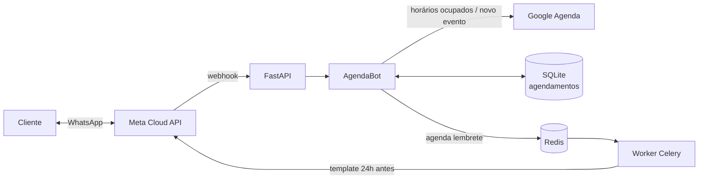

# AgendaBot 📅

Agendamento pelo WhatsApp para clínicas e salões. O cliente escolhe o serviço, o dia e o horário direto no chat. O bot consulta a agenda real, reserva o horário e envia um lembrete 24h antes com botões para confirmar, remarcar ou cancelar.


## O que ele faz

- **Agendamento guiado** com listas do WhatsApp: serviço → dia → (manhã ou tarde) → horário → confirmação.
- **Horários livres calculados de verdade**: respeita expediente, horário de almoço, duração de cada serviço e antecedência mínima de 2h.
- **Google Agenda**: considera ocupado tudo que já estiver na agenda da clínica (inclusive compromissos marcados à mão) e cria o evento ao confirmar.
- **Proteção contra conflito**: se outro cliente pegar o horário enquanto você decide, o bot avisa e mostra outras opções.
- **Lembrete 24h antes** com Celery + Redis, usando template aprovado pela Meta (necessário fora da janela de 24h).
- **Confirmar, remarcar ou cancelar** pelo lembrete ou pelo menu "Meus agendamentos".

## Exemplo de conversa

```
você › oi
bot  › Olá, Ana! 👋 Aqui é o assistente de agendamentos da Clínica Sorriso.
       [Agendar horário]  [Meus agendamentos]
você › Agendar horário
bot  › Qual serviço você quer agendar?
       ☰ Avaliação · Limpeza dental · Restauração · Clareamento
você › Limpeza dental
bot  › Limpeza dental (30 min). Qual dia fica melhor?
       ☰ seg 09/11 — 8 horários livres · ter 10/11 — 17 horários livres ...
você › ter 10/11
bot  › ter 10/11: prefere manhã ou tarde?   [Manhã (8)]  [Tarde (9)]
você › Tarde
bot  › ☰ 13:30 · 14:00 · 14:30 · ...
você › 14:00
bot  › Confirma o agendamento? 🦷 Limpeza dental 📅 terça, 10/11 às 14:00
       [Confirmar]  [Outro horário]  [Cancelar]
você › Confirmar
bot  › Prontinho, agendado! ✅ Vou te mandar um lembrete um dia antes.
```

## Como funciona



- `schedule.py` tem as regras (serviços, expediente, cálculo de vagas). É Python puro e coberto por testes.
- `calendar_provider.py` tem duas implementações com os mesmos métodos: `LocalCalendar` (usa só o banco) e `GoogleCalendar`. Troque com `CALENDAR_PROVIDER`.
- `tasks.py` é o worker do Celery que envia o lembrete no horário programado.

## Rodando no seu computador

```bash
git clone https://github.com/mauricio729/agendabot.git
cd agendabot
python -m venv .venv
source .venv/bin/activate        # Windows: .venv\Scripts\activate
pip install -r requirements.txt
```

**Simulador no terminal** (sem WhatsApp, sem Google):

```bash
python -m app.simulator
```

Digite o número das opções para navegar. Depois de agendar, digite `lembrete` para ver o lembrete e testar as respostas.

**Testes:**

```bash
pytest
```

**API local:**

```bash
cp .env.example .env
uvicorn app.main:app --reload     # http://localhost:8000/docs
```

**Tudo junto com Docker** (API + worker + Redis):

```bash
docker compose up --build
```

## Configurando as integrações

### WhatsApp

Mesmo processo do [ZapAtende](https://github.com/mauricio729/zapatende#conectando-ao-whatsapp-de-verdade): crie o app na Meta, preencha o token e o ID do número no `.env` e aponte o webhook para `https://SEU-TUNEL/webhook`.

Para os lembretes, crie no WhatsApp Manager o template `lembrete_consulta` (categoria Utilidade):

> Olá, {{1}}! Lembrete do seu horário de {{2}} na {{3}}: {{4}}. Podemos confirmar sua presença?

Com três botões de resposta rápida: **Confirmar**, **Remarcar** e **Cancelar**.

### Google Agenda (OAuth2)

1. No [Google Cloud Console](https://console.cloud.google.com/), ative a **Google Calendar API**.
2. Crie um **ID do cliente OAuth** do tipo "App para computador" e salve o JSON como `credentials.json` na raiz do projeto.
3. Rode `python scripts/autorizar_google.py` e entre com a conta da clínica. Isso gera o `token.json`.
4. No `.env`, defina `CALENDAR_PROVIDER=google`.

## Personalizando

Serviços, preços, duração e horário de funcionamento ficam em `app/schedule.py`:

```python
Service("limpeza", "Limpeza dental", 30, 150),
OPENING_HOURS = {0: [(time(8), time(12)), (time(13, 30), time(18))], ...}
```

## Estrutura

```
app/
├── bot.py                # fluxo da conversa
├── calendar_provider.py  # agenda local ou Google Agenda
├── container.py          # monta os objetos a partir do .env
├── main.py               # API: webhook e /agenda
├── reminders.py          # quando e como agendar o lembrete
├── schedule.py           # serviços, expediente e cálculo de vagas
├── simulator.py          # conversa pelo terminal
├── storage.py            # SQLite: agendamentos
├── tasks.py              # worker Celery que envia o lembrete
└── whatsapp.py           # Cloud API
scripts/autorizar_google.py
tests/
```

---

Feito por [Mauricio Rodrigues](https://github.com/mauricio729) · Uberlândia, MG
